# Cubrí Seguros · Flujo de contratación digital

Front-end de un checkout de contratación de **seguro de celular**: el usuario elige el producto, cotiza, elige un plan, carga sus datos, paga (simulado) y recibe su número de póliza.

Trabajo práctico de **Diseño UX/UI 2026** (Licenciatura en Sistemas de Información · FCyT, Sede Concepción del Uruguay).

| | |
|---|---|
| **Sitio publicado** | https://nahux-controlz.github.io/cubri-seguros/ |
| **Diseño base** | [Figma · Mobile 390 y Desktop 1440](https://www.figma.com/design/vJrfOUfiOI7OSeTtRfCloh) |
| **Stack** | HTML5 · Tailwind CSS v4 · Basecoat UI 1.1.0 · JavaScript vanilla (sin frameworks ni librerías de validación) |

> [!IMPORTANT]
> No hay backend ni pagos reales. Usá solo las tarjetas de prueba: **4111 1111 1111 1111** (aprobada) y **4000 0000 0000 0002** (rechazada).

## Capturas

| Pantalla | Mobile (390) | Desktop (1440) |
|---|---|---|
| 01 · Inicio / Catálogo | 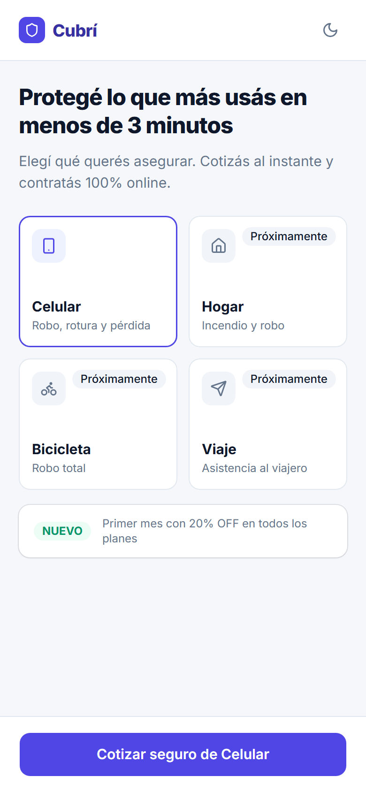 | 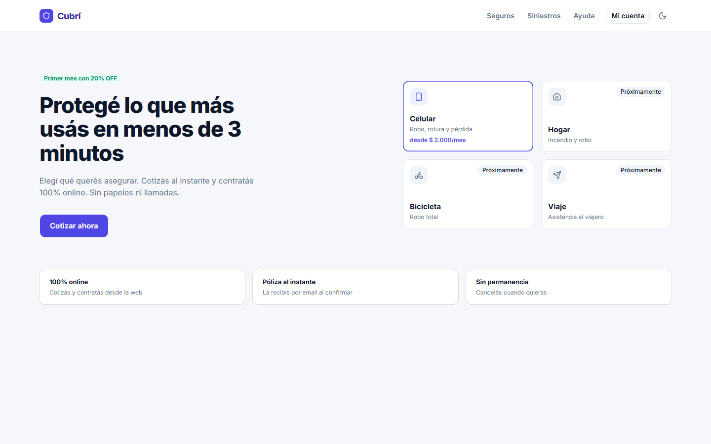 |
| 02 · Cotizar (Paso 1) | 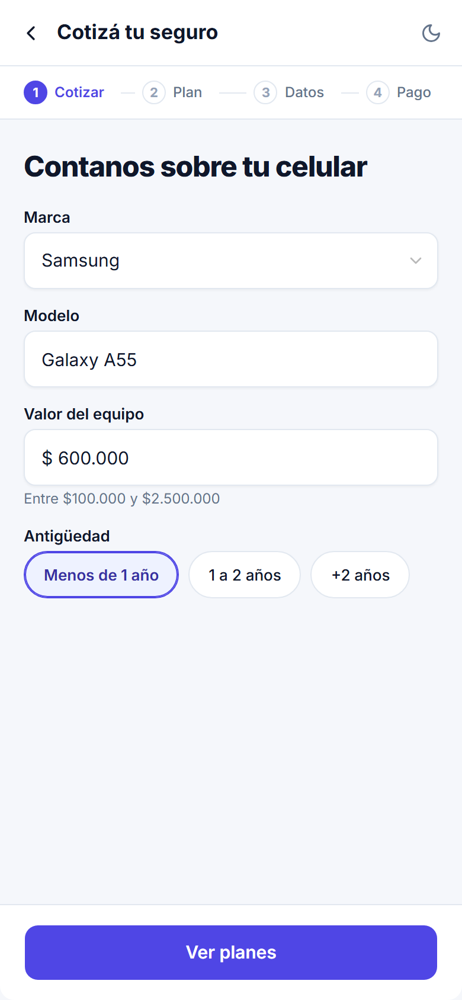 | 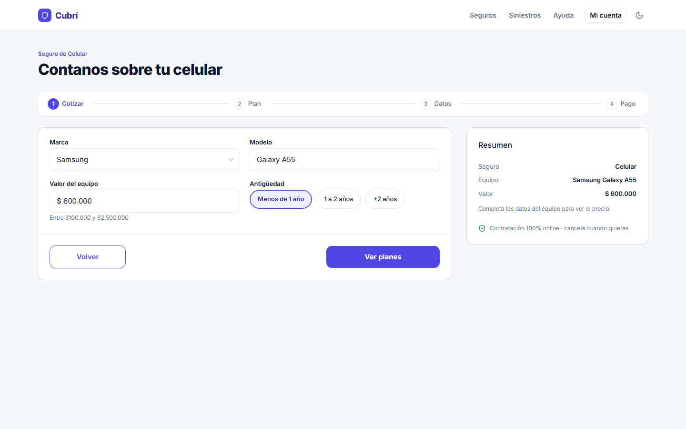 |
| 03 · Elegir plan (Paso 2) | 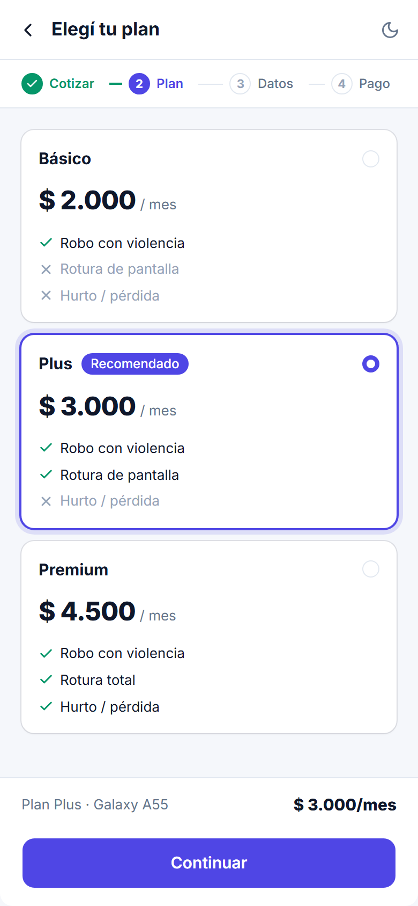 | 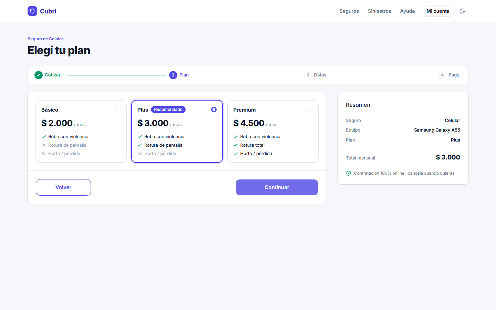 |
| 04 · Datos personales (Paso 3) | 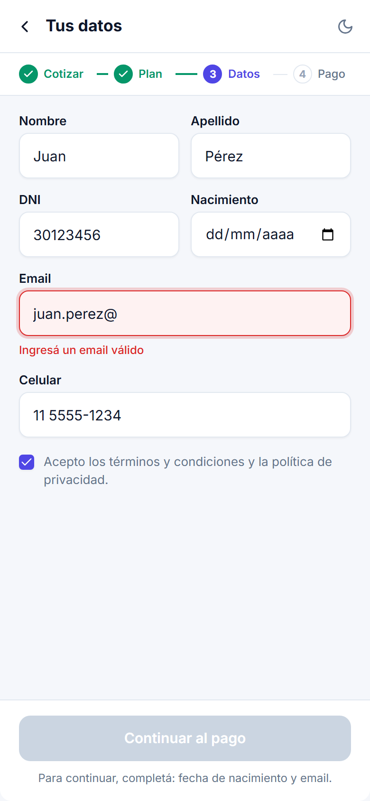 | 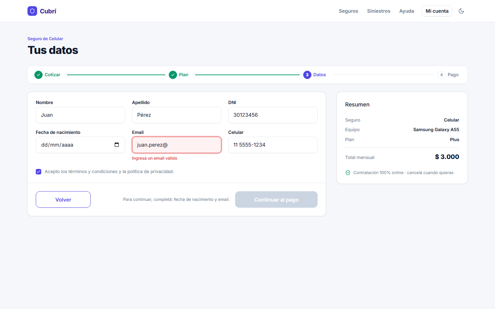 |
| 05 · Pago (Paso 4) | 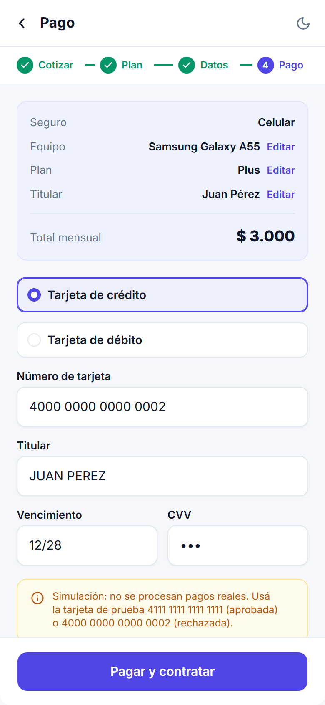 | 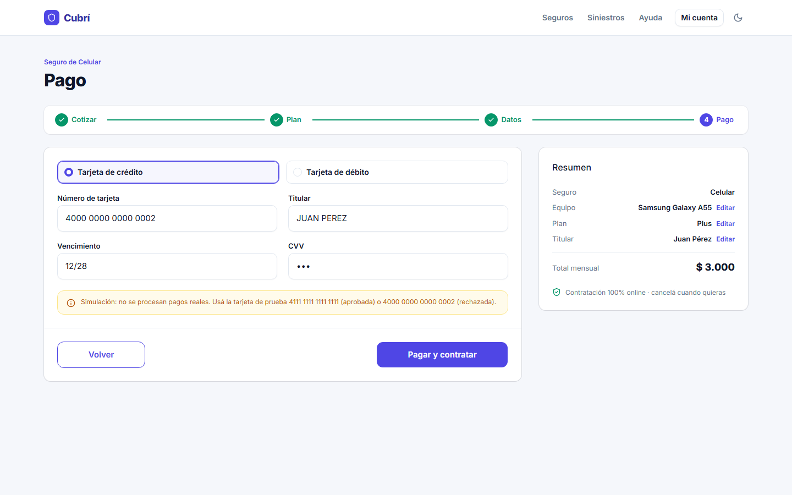 |
| 06 · Éxito | 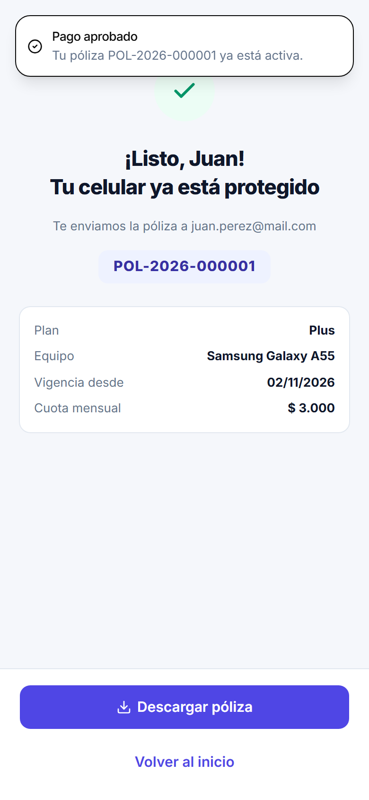 | 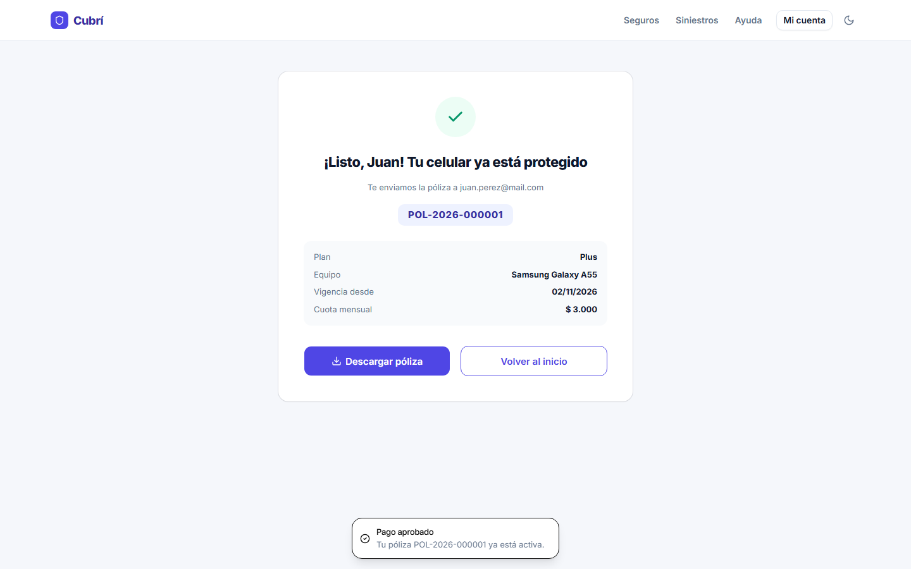 |
| 07 · Error de pago | 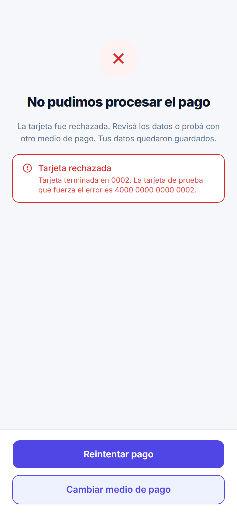 | 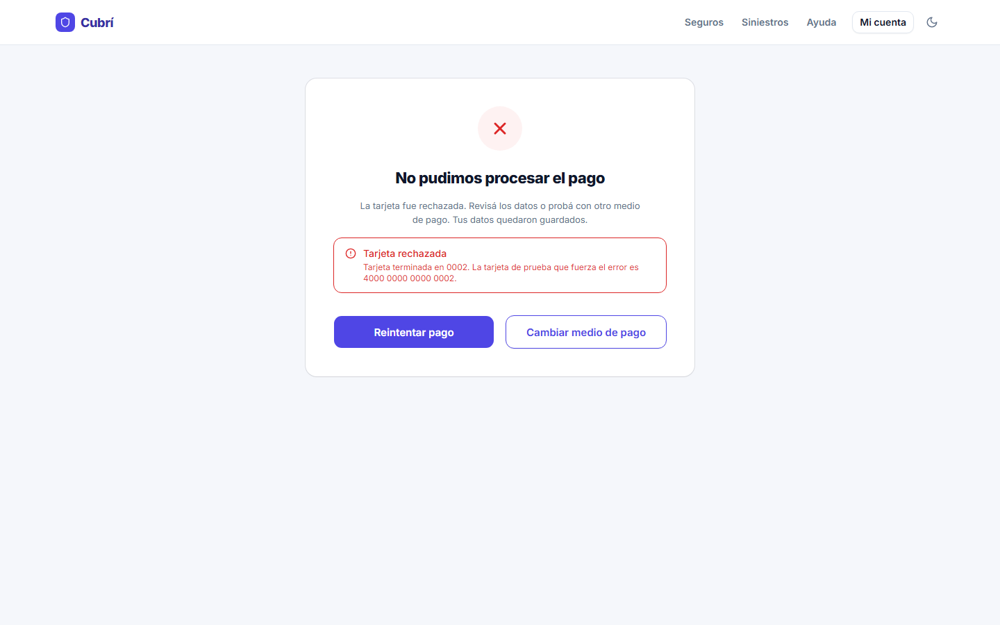 |
| Bonus · Modo oscuro | 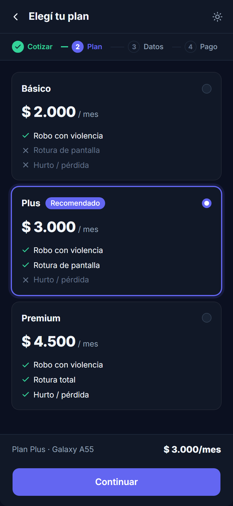 | 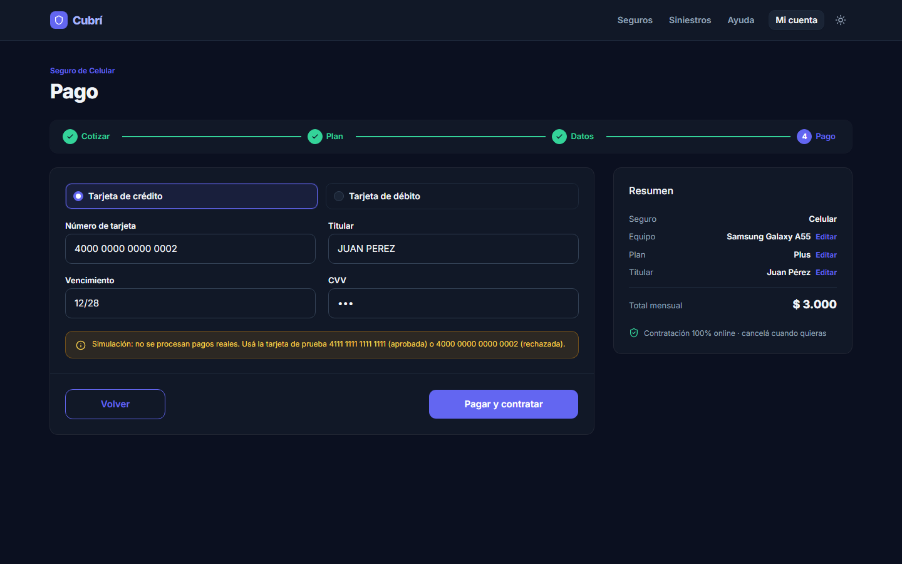 |

## Cómo correrlo

El proyecto no necesita compilación (opción 3.2 del enunciado: Basecoat y Tailwind por CDN). Solo hace falta **servirlo por HTTP**: si se abre `index.html` con doble click (`file://`) el navegador bloquea los módulos de JavaScript y el `fetch` de `data/planes.json`.

```bash
git clone https://github.com/nahux-controlz/cubri-seguros.git
cd cubri-seguros
npx serve .
```

También sirve la extensión **Live Server** de VS Code o `python -m http.server`. Después abrir la URL que muestra la consola (por ejemplo `http://localhost:3000`).

### Tests

```bash
npm test
```

Usa el test runner que trae Node (18 o superior), sin instalar dependencias. Son 30 tests de las funciones puras: los **3 casos de prueba de la cuota**, todas las reglas y mensajes de validación, el pago simulado, el formato de póliza y las máscaras.

| Caso (sección 5.1) | Básico | Plus | Premium | Test |
|---|---|---|---|---|
| $ 600.000 · menos de 1 año | $ 2.000 | $ 3.000 | $ 4.500 | ✅ |
| $ 600.000 · 1 a 2 años | $ 2.200 | $ 3.300 | $ 4.950 | ✅ |
| $ 1.200.000 · más de 2 años | $ 5.000 | $ 7.500 | $ 11.250 | ✅ |

## Estructura

```
cubri-seguros/
├── index.html              ← una sola página: cada paso es una <section data-paso> que se muestra u oculta
├── css/
│   ├── tokens.css          ← tokens del Figma sobre las variables de Basecoat (+ modo oscuro)
│   └── app.css             ← stepper, chips, cards de plan, resumen y ajustes de tamaño
├── data/
│   └── planes.json         ← Básico, Plus y Premium (se cargan con fetch)
├── js/
│   ├── app.js              ← arranque, eventos y navegación
│   ├── estado.js           ← objeto solicitud + funciones para modificarlo
│   ├── render.js           ← pinta cada paso a partir del estado
│   ├── validaciones.js     ← funciones puras: reciben un valor y devuelven error o null
│   ├── cotizador.js        ← calcularCuota() y formato de moneda
│   ├── pago.js             ← simularPago() y generarPoliza()
│   ├── persistencia.js     ← bonus: localStorage
│   ├── mascaras.js         ← bonus: máscaras de input
│   └── tema.js             ← bonus: modo oscuro sin parpadeo
├── tests/                  ← npm test (node:test)
├── docs/capturas/          ← capturas del README
└── .github/workflows/      ← tests + deploy a GitHub Pages
```

## Cómo funciona

- **Un único estado.** Toda la información vive en el objeto `solicitud` de `estado.js`. Cada evento modifica el estado y después llama a `render()`; el DOM nunca se lee para calcular nada. Lo que no es parte de la solicitud (campos ya tocados, pago en curso, catálogo de planes) vive aparte, en `ui`.
- **`render()` es idempotente.** Muestra/oculta las secciones con `hidden`, pinta el stepper (completo / activo / pendiente), rellena los inputs desde el estado (por eso "Volver" nunca pierde datos), recalcula cuotas y resumen, y habilita o deshabilita los botones.
- **Una sola función de precios.** `calcularCuota(valor, tasaAnual, factor)` = `Math.round(valor × tasaAnual / 12 × factor)`. La usan las cards de plan, el resumen, la pantalla de éxito y el comprobante, así que el precio no puede diferir entre pantallas.
- **Validaciones puras.** Cada regla es una función `validarX(valor) → mensaje | null`. `CAMPOS_POR_PASO` dice qué se valida en cada paso y `validarPaso()` devuelve los errores. El error de cada campo aparece al salir de él (blur), no mientras se escribe la primera letra, y desaparece en cuanto se corrige.
- **El resumen se genera una sola vez.** Hay un único `<aside id="resumen">` que llena `renderResumen()`. CSS decide cómo se ve según el paso (`body[data-vista]`): card lateral de 380 px en desktop, barra fija arriba del botón en el paso 2 mobile y card arriba del formulario en el pago mobile.
- **Pago.** Al pagar se revalida todo; si está bien, el botón pasa a "Procesando…" y queda deshabilitado durante 1,5 s (no hay doble pago). Si se aprueba se genera la póliza `POL-AAAA-NNNNNN`; si se rechaza se muestra el error y el botón se vuelve a habilitar al reintentar.

## Decisiones tomadas

1. **CDN, sin build.** Se usó la opción recomendada (3.2). Para que las utilidades de Tailwind usen los colores del diseño (`bg-primary-50`, `text-muted-foreground`, …) hay un bloque `<style type="text/tailwindcss">` con `@theme inline` que apunta a las variables de `tokens.css`.
2. **Basecoat primero.** Botones (`.btn` con `data-variant`), campos (`.field` con `data-invalid`, `aria-invalid` y `role="alert"`), `.card`, `.badge` y `.alert` son de Basecoat. Stepper, chips y cards de plan se armaron con Tailwind y CSS propio, como pide el mapeo del enunciado.
3. **Ajustes de tamaño fuera de capa.** Basecoat usa selectores muy específicos para los inputs (p. ej. `.field > input[type='text']:not(:is(...))`) y para `[role='radiogroup']`. Para llegar al alto de 48 px y al radio del Figma, esas reglas van sin `@layer` en `app.css`; el resto va en `@layer components` para que las utilidades de Tailwind sigan pudiendo pisarlo.
4. **`planes.json` con `noIncluye`.** Se respetó el JSON del enunciado y se agregó `noIncluye` para pintar las coberturas tachadas (✕) que muestra el Figma. Las cards se clonan de un `<template>`.
5. **Botones deshabilitados con explicación.** "Ver planes" y "Continuar al pago" se habilitan por JS solo con todo válido, y un texto dice qué falta ("Para continuar, completá: fecha de nacimiento y email."). En el pago el botón queda habilitado y, al intentar pagar, se muestran todos los errores y el foco va al primer campo inválido.
6. **"Volver" en todos los pasos.** En mobile es la flecha de la barra superior; en desktop es el botón outline a la izquierda (también en el paso 1, que en el Figma no lo tenía).
7. **Titular de la tarjeta también en mobile.** El Figma mobile no lo muestra, pero el enunciado lo pide en el paso 4.
8. **Reglas que el enunciado deja abiertas:** el vencimiento del mes en curso se toma como válido (la tarjeta vale hasta fin de mes); el celular se valida con `/^(?!0|15)\d{10}$/` después de quitar espacios y guiones; nombre y apellido aceptan letras, espacios, apóstrofo y guion; el DNI acepta puntos al escribir.
9. **Número de póliza.** El contador de `generarPoliza()` se guarda en `localStorage` para que no se repita entre visitas.
10. **"Descargar póliza"** genera un comprobante `.txt` con los datos del estado (no hay backend que emita un PDF).
11. **Accesibilidad.** Cada input con su `<label for>`, errores con `aria-invalid`, `aria-describedby` y `role="alert"`, foco al primer error, foco al título al cambiar de paso, `aria-current="step"` en el stepper, título de la pestaña por paso, link "Saltar al contenido" y radios reales (mismo `name`) para planes, antigüedad y medio de pago.

## Checklist del enunciado

- [x] Las 7 pantallas existen y se ven bien en 390 px y en 1440 px.
- [x] Los 3 casos de prueba de la sección 5.1 dan exactamente el valor esperado (`npm test`).
- [x] No se puede avanzar con datos inválidos y cada error tiene su mensaje.
- [x] "Volver" conserva los datos en todos los pasos.
- [x] La tarjeta 4000 0000 0000 0002 lleva al error y "Reintentar" vuelve al pago con todo cargado.
- [x] La póliza tiene formato POL-AAAA-NNNNNN.
- [x] No hay errores en la consola del navegador.
- [x] El sitio está publicado y el README tiene capturas y la URL.

Además de los tests unitarios, el flujo completo se probó de punta a punta en Chrome (mobile y desktop) con un script de DevTools Protocol: navegación, validaciones en blur, cuotas, pago aprobado y rechazado, doble click en "Pagar", persistencia y edición desde el resumen.

## Bonus

| Bonus | Estado | Detalle |
|---|---|---|
| Persistencia | ✅ | La solicitud sobrevive a un F5 (`js/persistencia.js`) y se borra al emitir la póliza. Número de tarjeta, vencimiento y CVV **no** se guardan. Al restaurar se valida cada dato y no se saltean pasos inválidos. |
| Editar desde el resumen | ✅ | Links "Editar" en equipo, plan y titular del resumen de pago. El botón del paso pasa a "Guardar y volver al pago". |
| Toast de Basecoat | ✅ | Al confirmar el pago. Se cargan solo `basecoat.min.js` (registro de componentes) y `toast.min.js`. |
| Máscaras de input | ✅ | Tarjeta en grupos de 4, vencimiento con barra automática, CVV solo dígitos y miles en el valor, sin que el cursor salte. |
| Modo oscuro | ✅ | Variables de Basecoat redefinidas bajo `.dark`; respeta la preferencia del sistema y recuerda la elección. |
| Vite + GitHub Actions | ◐ parcial | Hay deploy automático con GitHub Actions (tests + publicación en Pages en cada push), pero se mantuvo la opción sin build en lugar de Vite. |
| Habilitar otro producto | — | No se hizo: Hogar, Bicicleta y Viaje quedan como "Próximamente". |

## Hitos y commits

| Hito | Commit |
|---|---|
| H1 · Maquetado | Tokens y estilos base · maquetado estático de las 7 pantallas |
| H2 · Navegación y estado | Estado único, `render()`, stepper y "Volver" |
| H3 · Validaciones y cálculo | `planes.json` + `calcularCuota()` con los casos de prueba · validaciones en blur y botones deshabilitados |
| H4 · Pago y cierre | Pago simulado, póliza, éxito/error · bonus · README y deploy |

---

Marca ficticia, datos simulados y sin pagos reales. Íconos de [Lucide](https://lucide.dev) (ISC).
